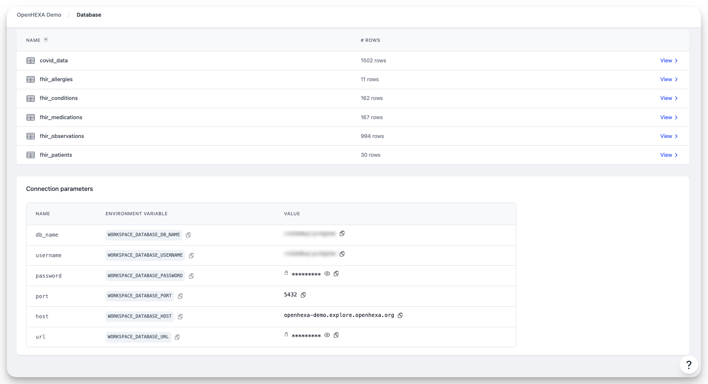

  <h1><i class="fas fa-hexagon" style="margin-right: 0.5rem;"></i>Database</h1>

Every workspace has a dedicated PostgreSQL relational database. You can use this database to store structured (relational) data for your workspace. You can easily access it from external visualization solutions such as Tableau or Power BI.

## Features

All workspace members can browse database tables and preview data in each table. However, access to database credentials and write permissions depend on your role:

!!! info "Database permissions by role"
    - **Viewers**: Can browse tables and view data, but cannot see database credentials or write to the database
    - **Editors**: Can browse tables, view data, access database credentials, and write to the database
    - **Admins**: Can browse tables, view data, access database credentials, write to the database, and regenerate database passwords

You can use the workspace database in OpenHEXA notebooks and OpenHEXA data pipelines.

You can also use your OpenHEXA workspace database as a data source in data visualization and BI tools like Tableau or Power BI. Simply copy the connection parameters from the database page and paste them into your tool.

## Database credentials

Each workspace provides two sets of database credentials:

### Read-only connection

The read-only connection is recommended for visualization tools like Superset, Power BI, Tableau, and other dashboard applications. This connection only allows `SELECT` queries, preventing accidental data modifications when exploring data.

The read-only credentials include:

- **Host**: The database server address
- **Port**: The connection port
- **Database name**: Your workspace database name
- **Username**: A read-only user (ending in `_ro`)
- **Password**: Auto-generated password
- **Connection URL**: A complete PostgreSQL connection string

### Read/write connection (full access)

The full access connection is intended for notebooks and pipelines that need to create, update, or delete data. Use these credentials when your code needs to write to the database.

!!! warning "Use read-only credentials for dashboards"
    When connecting visualization tools, always use the read-only credentials. This prevents accidental data modifications and follows the principle of least privilege.

### Regenerate passwords

Workspace Admins can regenerate database passwords if they are compromised:

1. Go to **Settings** in your workspace.
2. In the **Database** section, click **Regenerate password** for the credentials you want to reset.

!!! warning "Password regeneration impact"
    Regenerating a password will immediately invalidate the old password. Any tools or pipelines using the old credentials will need to be updated.

## Connect to Apache Superset

Apache Superset is a popular open-source data visualization and exploration platform. You can connect your OpenHEXA workspace database to Superset for advanced analytics and dashboard creation.

1. **Access database connection parameters**
    - Go to your workspace database page in OpenHEXA.
    - Copy the connection parameters (host, port, database name, username, and password).

2. **Add database in Superset**
    - In Superset, go to **Settings** > **Database Connections**.
    - Click **+ Database** to add a new connection.
    - Select **PostgreSQL** as the database type.

3. **Configure connection**
    - **Host**: The host from your OpenHEXA database parameters
    - **Port**: The port from your OpenHEXA database parameters
    - **Database Name**: The database name from your workspace
    - **Username**: The provided username
    - **Password**: The provided password
    - **Display Name**: A descriptive name for your connection (for example, "OpenHEXA Workspace DB")

4. **Test and save**
    - Click **Test Connection** to verify the setup.
    - If successful, click **Connect** to save the database connection.

## Make a saved query public

A query saved in the Data Studio has one of three visibilities:

- **Private**: only its author can see and run it.
- **Workspace**: every member of the workspace can see and run it.
- **Public**: everything **Workspace** allows, plus a public link that anyone can open, even without an OpenHEXA account.

A public link (`/queries/<slug>`) shows the query's name, description and result. Visitors can change how many rows are shown and download the full result as CSV. They never see the SQL, its author or the workspace it belongs to. Public links are hidden from search engines.

!!! info "Who can make a query public"
    - The author of the query, if they are an editor or admin of the workspace (viewers cannot make queries public)
    - Workspace admins
    - Organization admins and owners

    The same people can take a public query back to **Workspace**. Making a query **Private** remains the author's decision only. A private query can only be made public by its author.

    Only these people can change the SQL of a public query, because visitors run whatever it contains. Workspace editors can still rename it, change its description or save a copy. Deleting a public query breaks its link, so only its author and the people above can delete it.

To make a query public, open it in the Data Studio, click its visibility in the toolbar and choose **Public**. Copy the link from the **Public link** button in the toolbar or from the saved queries list.

If a query stops being public, its link stops working: visitors who are not logged in are sent to the login page, and everyone else gets a "page not found" error.
