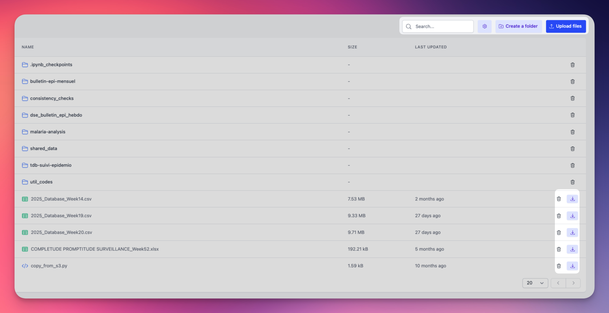

<div class="hero-section">
  <h1><i class="fas fa-hexagon" style="margin-right: 0.5rem;"></i>Files</h1>
</div>
</div>
Every workspace includes a shared filesystem that serves as the foundation for OpenHEXA's data lakehouse architecture. This filesystem provides:

- A centralized location for storing raw data files before processing
- Intermediate storage for data transformations and pipelines
- Support for structured and unstructured data
- Integration with data processing tools like notebooks and pipelines



The file browser interface provides several key features:

- Search for files and folders by name
- Toggle visibility of hidden files (starting with ".")
- Create folders to organize your workspace (Editors and Admins only)
- Upload files or entire folders to your workspace (Editors and Admins only)

Files are displayed in a table showing:

- File/folder names with type icons
- File sizes in readable format
- Last modified dates with sorting capability

You can perform common file operations:

- Download files to your local machine (all workspace members)
- Delete files and folders when no longer needed (Editors and Admins only)

!!! info "File permissions by role"
    - **Viewers**: Can browse, search, and download files
    - **Editors and Admins**: Can browse, search, download, upload, create folders, and delete files

## Public files

A workspace can make some of its files available to anyone, without signing in. This is useful to feed a public web app, a map (for example `.pmtiles` tiles) or an external tool.

Only files in a folder named `public` at the root of the filesystem are concerned. Each of them is reachable at a stable URL:

```
https://<your-openhexa-instance>/files/<workspace_slug>/public/<path_inside_public_folder>
```

For example, `public/maps/regions.pmtiles` is served at `/files/<workspace_slug>/public/maps/regions.pmtiles`.

- The URL redirects to a short-lived download link of the storage backend. On cloud storage (Google Cloud Storage, S3, Azure), range requests are supported. The local filesystem backend always returns the whole file.
- Files are always sent as downloads: opening a link in a browser tab downloads the file instead of displaying it. Reading them from code (`fetch()`, ``, map libraries) is not affected.
- Any website can fetch these files (CORS is open to all origins). On Azure, cross-origin access also requires CORS to be configured on the storage account, as OpenHEXA does not set it up.
- Folder contents are never listed, and files outside the `public` folder, or whose name starts with a ".", are never served.
- The redirect may be cached for up to 5 minutes, so a file can remain reachable for a few minutes after the setting is turned off.

Public files are disabled by default. To enable them:

1. The instance must have the `PUBLIC_FILES_ENABLED=true` environment variable set.
2. A workspace admin (or an organization admin or owner) turns on **Public files** in the workspace settings.

Once enabled, the `public` folder shows a globe icon and each file inside it has a button to copy its public link. While the `public` folder does not exist, a greyed-out placeholder at the root of the filesystem shows the next step: enabling the setting, or creating the folder.

!!! warning
    Anyone who has the link of a public file can download it. Check the content of the `public` folder before enabling the setting, and never put sensitive data in it.

## Integration with OpenHEXA tools

The workspace filesystem integrates seamlessly with other OpenHEXA components:

- **Notebooks**: Access files directly from Jupyter notebooks using the workspace filesystem. See [Notebooks](notebooks.md).
- **Data Pipelines**: Read and write files in your data processing workflows. See [OpenHEXA SDK](sdk.md).
