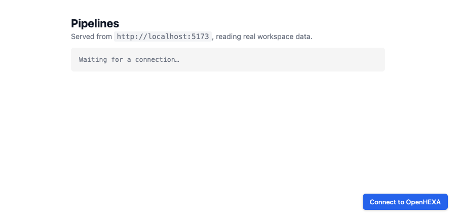
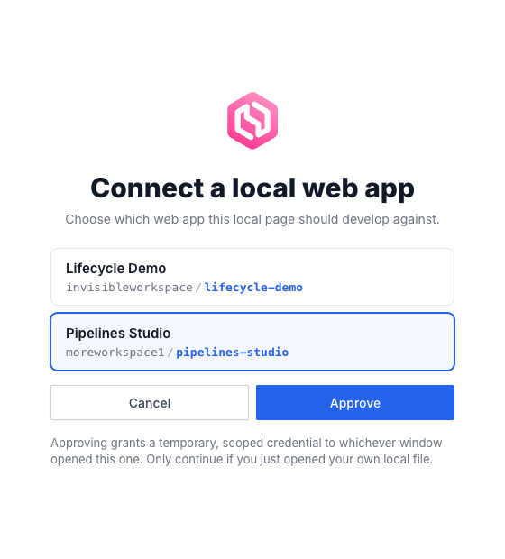
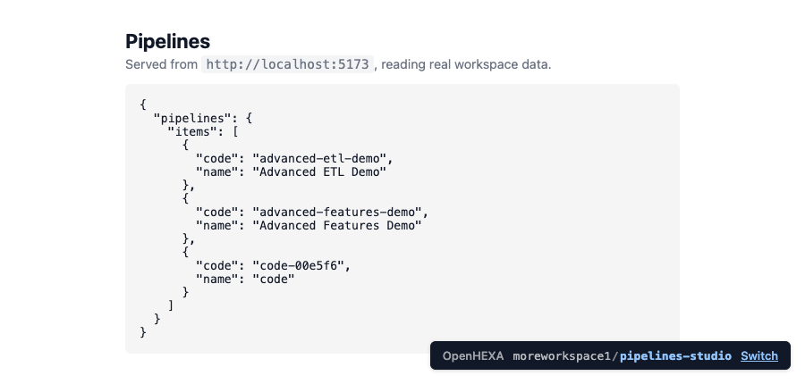

<div class="hero-section">
  <h1><i class="fas fa-hexagon" style="margin-right: 0.5rem;"></i>Static Webapps</h1>
</div>
</div>

Static webapps host an HTML/CSS/JavaScript bundle inside an OpenHEXA workspace, served on its own subdomain, and can query OpenHEXA on behalf of viewing users via a pre-authenticated GraphQL endpoint — great for dashboards and custom forms.

OpenHEXA supports three webapp types:

- **Static** (this page): you provide the source files; OpenHEXA serves them and proxies API access for you.
- **Iframe**: OpenHEXA embeds an external URL.
- **Superset**: OpenHEXA embeds a Superset dashboard.

## Creating a static webapp

From the workspace UI, click **Web Apps → Create**, then pick one of:

- **Create with AI**: describe the web app and the assistant writes a first version, then opens it in the code editor so you can keep refining it in the chat. Only offered when AI is enabled for your organization.
- **From code**: drop in your files or start from the default `index.html` template.

Programmatically: use the `create_static_webapp` MCP tool, or the GraphQL `createWebapp` mutation with a `static` source carrying a list of `{path, content}` files. An `index.html` at the root is required.

## Project structure

Files live at the paths you provide. `index.html` is the entry point; everything else (CSS, JS, images, JSON fixtures) is served as-is from the same origin.

```
index.html
app.js
style.css
assets/logo.svg
```

Reference assets with relative paths (`<script src="app.js">`, `<link href="style.css">`) so they work both in preview and once published.

## URL and subdomain

Each webapp gets a subdomain under the workspace's webapps domain — e.g. `my-webapp.webapps.example.com`. The subdomain defaults to the slug derived from the webapp name and can be edited in the webapp settings.

## Public vs private

- **Private** (default): viewers must be authenticated workspace members. Private static webapps can also call OpenHEXA's GraphQL API through an endpoint on their own URL (see below).
- **Public**: anyone with the URL can view the webapp. Public webapps **cannot** call the GraphQL proxy — if you need to expose workspace data publicly, generate a static export from a pipeline and serve it as a file inside the webapp.

## Calling the OpenHEXA GraphQL API

Private static webapps can call the platform's GraphQL API from their JavaScript code, through an endpoint on their own URL, to read workspace data and run pipelines. The rest of this page covers that API in detail — public webapps and iframe webapps cannot use this endpoint.

### How it works

- **Endpoint**: `POST /graphql/` on the webapp's own URL (same-origin). For example, a webapp served at `https://my-webapp.webapps.example.com/` calls `https://my-webapp.webapps.example.com/graphql/`.
- **Authentication**: handled by the webapp session — the user's browser session cookie is attached automatically. Do not send `Authorization` headers; do not embed tokens in your code.
- **Origin check**: only requests whose `Origin` matches the webapp's own origin are allowed. Cross-site calls are rejected.
- **Scope-gated**: each webapp declares an `allowed_operations` list. Every field a query selects is checked against those scopes, including nested fields and fields inside fragments. If any field is not covered, the whole request returns a `403` naming the refused fields and, when a scope would grant them, the scopes to enable, for example `Fields not allowed: Workspace.datasets. Enable scope(s): DATASETS_READ`. Fields no scope covers, such as `Workspace.connections`, are listed without a hint.
- **Viewer's role, narrowed by scopes**: the webapp acts as the viewing user, but can only use what both the user's workspace role and the webapp's scopes allow. Credentials (database passwords, connection secrets, tokens) are never available to a webapp.
- **Own endpoint only**: the main OpenHEXA API refuses requests coming from webapp pages. Always call `/graphql/` on the webapp's own URL.
- **JSON body**: same as any GraphQL POST — `{"query": "...", "variables": {...}}`.

## Enabling the API on a webapp

By default a static webapp has an empty `allowed_operations` list, which means it cannot call the API. Enable scopes from the workspace UI ("Webapp settings → API access") or via the GraphQL `updateWebapp` mutation.

## Scope reference

| Scope | Entry points |
|---|---|
| `USER_READ` | `me`, `workspace`, `countries`, `country`, `boundaries` |
| `PIPELINES_READ` | `pipeline`, `pipelines`, `pipelineByCode`, `pipelineRun`, `pipelineVersion`, `pipelineParameterChoices` |
| `PIPELINES_RUN` | `runPipeline`, `stopPipeline` |
| `FILES_READ` | `getFileByPath`, `readFileContent`, `prepareObjectDownload` |
| `DATASETS_READ` | `dataset`, `datasets`, `datasetVersion`, `datasetLink`, `datasetLinkBySlug`, `datasetVersionFile` |
| `DATABASE_READ` | `executeSavedQuery` |

Each scope also covers the fields of the objects these entry points return, as shown in the schema of the [examples](#example-webapps) below. Links back up to a workspace, such as `Pipeline.workspace`, `Dataset.workspace` or `DatasetLink.workspace`, are not covered by any scope.

Some fields need a second scope:

- Listing files through `workspace { bucket { objects } }` needs `USER_READ` and `FILES_READ`.
- Listing datasets through `workspace { datasets }` needs `USER_READ` and `DATASETS_READ`.
- Reading the dataset versions a run produced through `pipelineRun { datasetVersions }` needs `PIPELINES_READ` and `DATASETS_READ`.

Introspection fields `__typename`, `__schema`, `__type` are always allowed.

!!! note "Databases are read-only, and only through saved queries"

    A web app cannot send SQL of its own — `executeSQL` is refused on this
    endpoint whatever scopes are enabled. `DATABASE_READ` lets it run a query a
    workspace member wrote and saved in the Data Studio, addressed by slug. The
    SQL itself is never returned, so the app can run the query but not read or
    change it. Queries execute with the read-only database role.

!!! note "Bucket files and dataset files are read differently"

    Files in the **workspace bucket** and files in a **dataset version** live in
    separate storage, and neither API can read the other:

    - **Bucket files** (scope `FILES_READ`): read the content with
      `readFileContent`, or get a download link with `prepareObjectDownload`.
      Both take a path inside the workspace bucket.
    - **Dataset files** (scope `DATASETS_READ`): find the file from its version
      (`datasetVersion.files` or `datasetVersion.fileByName`), then either
      `fetch()` its `downloadUrl` for the full content, or read `fileSample` for
      a short preview of the rows. Passing a dataset file to `readFileContent` or
      `prepareObjectDownload` fails.

    See [Read a dataset file](#user_read-datasets_read-read-a-dataset-file) for
    a complete example.

## Exploring the schema

The fastest way to design queries for a webapp is the interactive GraphQL playground at <https://app.openhexa.org/graphql/> (or `/graphql/` on your own install).

Note that the playground shows the **full** schema, not just what the webapp proxy allows. A query that works there can still return `403` from a webapp at runtime if any field it selects, at the top level or nested, isn't covered by the webapp's [scopes](#scope-reference). The `403` names the refused fields, so check it before pasting into webapp code.

## The `window.OPENHEXA` global

When OpenHEXA serves your static webapp's HTML it injects a small script before `</head>` that exposes:

```js
window.OPENHEXA = Object.freeze({
  workspaceSlug: "my-workspace",   // slug of the workspace owning this webapp
  webappSlug: "my-webapp",         // this webapp's own slug
  isPublic: false,                 // true for public webapps
  url: "https://app.openhexa.org/workspaces/my-workspace/webapps/my-webapp", // page of this webapp in OpenHEXA
});
```

The examples below read `workspaceSlug` from this global, so they're copy-pasteable into any webapp without having to edit a constant. The injection only touches `text/html` responses; CSS, JS, and JSON files are untouched.

## Developing locally

You can build a webapp on your own machine — your editor, your live reload, your browser dev tools — while reading **real workspace data** through the same scope-gated API you get in production. No hand-rolled proxy and no manual token: it takes one script tag and two clicks.

### 1. Add the script to your page

```html
<script src="[[ BASE_URL ]]/webapps/dev.js"></script>
```

New webapps created from the default template already include this tag. It is inert once deployed (it only activates on `file://` and `localhost` pages), so you can leave it in your `index.html`.

### 2. Open your page and click Connect

Open your page in a browser where you're already logged into OpenHEXA — either open the `.html` file directly (`file://`) or serve it locally (any static server works, e.g. `python -m http.server 5173`).

A **Connect to OpenHEXA** button appears in the corner:



### 3. Pick a web app and approve

Clicking it opens a small OpenHEXA window listing the private static webapps you can develop against. Pick one and hit **Approve**:



### That's it

The window closes and your page reloads, connected. `window.OPENHEXA` is populated and your `fetch("/graphql/")` calls now return real data. A chip in the corner shows which webapp you're connected to:



### Skipping the picker

Name the workspace and webapp up front and the list is reduced to that single, preselected entry — you still confirm with **Approve**:

```html
<script src="[[ BASE_URL ]]/webapps/dev.js" data-workspace-slug="my-workspace" data-webapp-slug="my-webapp"></script>
```

### Good to know

- **Same permissions as production.** Your local calls respect the webapp's `allowed_operations` exactly as they will once deployed, so an operation that works locally won't surprise you with a `403` later.
- **The chip is your control.** Use **Switch** to move to a different webapp, or **Reconnect** to force a fresh credential.

---

## Example webapps

Each example below is a complete `index.html` you can drop into a static webapp. Every example inlines the same tiny `gql()` helper so it's standalone, and reads its workspace slug from `window.OPENHEXA`.

### USER_READ — Who am I?

Displays the current user and workspace on load.

<details markdown="1">
<summary>Schema</summary>

```graphql
type Query {
  me: Me!
  workspace(slug: String!): Workspace
}

type Me {
  user: User
  features: [FeatureFlag!]!
  permissions: MePermissions!
}

type User {
  id: UUID!
  email: String!
  firstName: String
  lastName: String
  displayName: String!
  language: String!
  avatar: Avatar!
}

type Workspace {
  slug: String!
  name: String!
  description: String
  countries: [Country!]!
  organization: Organization
  createdAt: DateTime!
  updatedAt: DateTime
  createdBy: User!
  currentMembership: WorkspaceMembership  # null when the viewer has access without being a member (e.g. organization admin)
}

type WorkspaceMembership {
  role: WorkspaceMembershipRole!  # ADMIN, EDITOR or VIEWER
}
```

[Browse the full schema in the playground →](https://app.openhexa.org/graphql/)

</details>

```html
<!DOCTYPE html>
<html>
<head>
  <meta charset="utf-8">
  <title>Who am I?</title>
  <script src="[[ BASE_URL ]]/webapps/dev.js"></script>
  <style>
    body { font-family: system-ui, sans-serif; max-width: 640px; margin: 2rem auto; padding: 0 1rem; }
    pre { background: #f5f5f5; padding: 1rem; border-radius: 4px; overflow-x: auto; }
  </style>
</head>
<body>
  <h1>Who am I?</h1>
  <pre id="out">Loading…</pre>

  <script>
    const { workspaceSlug } = window.OPENHEXA;

    async function gql(query, variables = {}) {
      const res = await fetch("/graphql/", {
        method: "POST",
        headers: { "Content-Type": "application/json" },
        body: JSON.stringify({ query, variables }),
      });
      const json = await res.json();
      if (json.errors) throw new Error(json.errors.map(e => e.message).join("; "));
      return json.data;
    }

    (async () => {
      const data = await gql(`
        query($slug: String!) {
          me { user { id email displayName } }
          workspace(slug: $slug) { slug name description }
        }
      `, { slug: workspaceSlug });
      document.getElementById("out").textContent = JSON.stringify(data, null, 2);
    })();
  </script>
</body>
</html>
```

### PIPELINES_READ — List pipelines

Lists every pipeline in the workspace.

<details markdown="1">
<summary>Schema</summary>

```graphql
type Query {
  pipelines(
    workspaceSlug: String
    name: String
    search: String
    tags: [String!]
    functionalType: PipelineFunctionalType
    lastRunStates: [PipelineRunStatus!]
    page: Int
    perPage: Int
    orderBy: PipelineOrderBy
  ): PipelinesPage!
}

type PipelinesPage {
  items: [Pipeline!]!
  pageNumber: Int!
  totalPages: Int!
  totalItems: Int!
}

type Pipeline {
  id: UUID!
  code: String!
  name: String
  description: String
  schedule: String
  currentVersion: PipelineVersion
  type: PipelineType!
}
```

[Browse the full schema in the playground →](https://app.openhexa.org/graphql/)

</details>

```html
<!DOCTYPE html>
<html>
<head>
  <meta charset="utf-8">
  <title>Pipelines</title>
  <script src="[[ BASE_URL ]]/webapps/dev.js"></script>
  <style>
    body { font-family: system-ui, sans-serif; max-width: 720px; margin: 2rem auto; padding: 0 1rem; }
    li { margin-bottom: 0.75rem; }
    code { background: #f5f5f5; padding: 0.1rem 0.3rem; border-radius: 3px; }
  </style>
</head>
<body>
  <h1>Pipelines</h1>
  <ul id="list"><li>Loading…</li></ul>

  <script>
    const { workspaceSlug } = window.OPENHEXA;

    async function gql(query, variables = {}) {
      const res = await fetch("/graphql/", {
        method: "POST",
        headers: { "Content-Type": "application/json" },
        body: JSON.stringify({ query, variables }),
      });
      const json = await res.json();
      if (json.errors) throw new Error(json.errors.map(e => e.message).join("; "));
      return json.data;
    }

    (async () => {
      const { pipelines } = await gql(`
        query($slug: String!) {
          pipelines(workspaceSlug: $slug, page: 1, perPage: 50) {
            items { id code name description schedule }
          }
        }
      `, { slug: workspaceSlug });

      const list = document.getElementById("list");
      list.innerHTML = "";
      for (const p of pipelines.items) {
        const li = document.createElement("li");
        li.innerHTML = `<strong>${p.name}</strong> <code>${p.code}</code><br><small>${p.description ?? ""}</small>`;
        list.appendChild(li);
      }
    })();
  </script>
</body>
</html>
```

### PIPELINES_READ + PIPELINES_RUN — Pick a pipeline and run it

Loads the list of pipelines on page open, lets you pick one from a dropdown, and runs it with a JSON config. Polls the run status until it terminates. Requires both `PIPELINES_READ` (to list) and `PIPELINES_RUN` (to launch).

<details markdown="1">
<summary>Schema</summary>

```graphql
type Query {
  pipelines(workspaceSlug: String, page: Int, perPage: Int): PipelinesPage!
  pipeline(id: UUID!): Pipeline
  pipelineRun(id: UUID!): PipelineRun
}

type Mutation {
  runPipeline(input: RunPipelineInput): RunPipelineResult!
  stopPipeline(input: StopPipelineInput!): StopPipelineResult!
}

input RunPipelineInput {
  id: UUID!
  versionId: UUID
  config: JSON!
  sendMailNotifications: Boolean
  enableDebugLogs: Boolean
}

input StopPipelineInput {
  runId: UUID!
}

type RunPipelineResult {
  success: Boolean!
  errors: [PipelineError!]!
  run: PipelineRun
}

type StopPipelineResult {
  success: Boolean!
  errors: [PipelineError!]!
}

type PipelineRun {
  id: UUID!
  status: PipelineRunStatus!
  progress: Int!
  executionDate: DateTime
  duration: Int
  outputs: [PipelineRunOutput!]!
}

union PipelineRunOutput = BucketObject | GenericOutput | DatabaseTable
```

[Browse the full schema in the playground →](https://app.openhexa.org/graphql/)

</details>

```html
<!DOCTYPE html>
<html>
<head>
  <meta charset="utf-8">
  <title>Run a pipeline</title>
  <script src="[[ BASE_URL ]]/webapps/dev.js"></script>
  <style>
    body { font-family: system-ui, sans-serif; max-width: 640px; margin: 2rem auto; padding: 0 1rem; }
    label { display: block; margin: 0.75rem 0 0.25rem; font-weight: 500; }
    select, textarea { width: 100%; padding: 0.4rem; box-sizing: border-box; font-family: inherit; }
    button { margin-top: 1rem; padding: 0.5rem 1rem; }
    button[disabled] { opacity: 0.5; cursor: not-allowed; }
    #status { margin-top: 1rem; font-weight: 600; }
  </style>
</head>
<body>
  <h1>Run a pipeline</h1>

  <label>Pipeline
    <select id="pipeline" disabled><option>Loading…</option></select>
  </label>
  <label>Config (JSON)
    <textarea id="cfg" rows="4">{}</textarea>
  </label>
  <button id="runBtn" disabled onclick="runIt()">Run</button>

  <p id="status"></p>

  <script>
    const { workspaceSlug } = window.OPENHEXA;

    async function gql(query, variables = {}) {
      const res = await fetch("/graphql/", {
        method: "POST",
        headers: { "Content-Type": "application/json" },
        body: JSON.stringify({ query, variables }),
      });
      const json = await res.json();
      if (json.errors) throw new Error(json.errors.map(e => e.message).join("; "));
      return json.data;
    }

    // 1. Load the pipeline list and populate the dropdown.
    (async () => {
      const { pipelines } = await gql(`
        query($slug: String!) {
          pipelines(workspaceSlug: $slug, page: 1, perPage: 100) {
            items { id code name }
          }
        }
      `, { slug: workspaceSlug });

      const select = document.getElementById("pipeline");
      if (!pipelines.items.length) {
        select.innerHTML = '<option>(no pipelines in this workspace)</option>';
        return;
      }
      select.innerHTML = pipelines.items
        .map(p => `<option value="${p.id}">${p.name} (${p.code})</option>`)
        .join("");
      select.disabled = false;
      document.getElementById("runBtn").disabled = false;
    })();

    // 2. Run the selected pipeline and poll until it terminates.
    async function runIt() {
      const id = document.getElementById("pipeline").value;
      const config = JSON.parse(document.getElementById("cfg").value || "{}");
      const status = document.getElementById("status");

      const { runPipeline } = await gql(`
        mutation($input: RunPipelineInput!) {
          runPipeline(input: $input) {
            success errors run { id status }
          }
        }
      `, { input: { id, config } });

      if (!runPipeline.success) {
        status.textContent = "Error: " + runPipeline.errors.join(", ");
        return;
      }

      const runId = runPipeline.run.id;
      status.textContent = "Running…";

      while (true) {
        await new Promise(r => setTimeout(r, 2000));
        const { pipelineRun } = await gql(
          `query($id: UUID!) { pipelineRun(id: $id) { status } }`,
          { id: runId },
        );
        status.textContent = "Status: " + pipelineRun.status;
        if (["success", "failed", "stopped", "skipped"].includes(pipelineRun.status)) break;
      }
    }
  </script>
</body>
</html>
```

### USER_READ + FILES_READ — Pick a CSV from the workspace bucket and preview it

Lists CSV files in the workspace bucket on page load, lets you pick one from a dropdown, and renders the first 100 lines as a table. Requires both `USER_READ` (to list files via `workspace.bucket.objects`) and `FILES_READ` (to read content).

<details markdown="1">
<summary>Schema</summary>

```graphql
type Query {
  getFileByPath(workspaceSlug: String!, path: String!): BucketObject
  readFileContent(
    workspaceSlug: String!
    filePath: String!
    startLine: Int
    endLine: Int
  ): ReadFileContentResult!
}

type Mutation {
  prepareObjectDownload(input: PrepareObjectDownloadInput!): PrepareObjectDownloadResult!
}

input PrepareObjectDownloadInput {
  workspaceSlug: String!
  objectKey: String!
  forceAttachment: Boolean = true
}

type BucketObject {
  key: String!
  name: String!
  path: String!
  size: BigInt
  updatedAt: DateTime
  type: BucketObjectType!
}

type ReadFileContentResult {
  success: Boolean!
  errors: [ReadFileContentError!]!
  content: String
  size: Int
}

type PrepareObjectDownloadResult {
  success: Boolean!
  downloadUrl: URL
  errors: [PrepareObjectDownloadError!]!
}
```

[Browse the full schema in the playground →](https://app.openhexa.org/graphql/)

</details>

```html
<!DOCTYPE html>
<html>
<head>
  <meta charset="utf-8">
  <title>Preview CSV</title>
  <script src="[[ BASE_URL ]]/webapps/dev.js"></script>
  <style>
    body { font-family: system-ui, sans-serif; max-width: 800px; margin: 2rem auto; padding: 0 1rem; }
    label { display: block; margin: 0.75rem 0 0.25rem; font-weight: 500; }
    select { width: 100%; padding: 0.4rem; box-sizing: border-box; font-family: inherit; }
    button { margin-top: 0.75rem; padding: 0.5rem 1rem; }
    button[disabled] { opacity: 0.5; cursor: not-allowed; }
    table { border-collapse: collapse; margin-top: 1rem; width: 100%; }
    th, td { border: 1px solid #ddd; padding: 0.3rem 0.5rem; font-size: 0.9rem; }
    th { background: #f5f5f5; }
    #status { margin-top: 1rem; color: #b91c1c; }
  </style>
</head>
<body>
  <h1>Preview CSV</h1>

  <label>File
    <select id="file" disabled><option>Loading…</option></select>
  </label>
  <button id="loadBtn" disabled onclick="load()">Load</button>

  <p id="status"></p>
  <div id="table"></div>

  <script>
    const { workspaceSlug } = window.OPENHEXA;

    async function gql(query, variables = {}) {
      const res = await fetch("/graphql/", {
        method: "POST",
        headers: { "Content-Type": "application/json" },
        body: JSON.stringify({ query, variables }),
      });
      const json = await res.json();
      if (json.errors) throw new Error(json.errors.map(e => e.message).join("; "));
      return json.data;
    }

    // 1. List CSV files in the bucket and populate the dropdown.
    (async () => {
      const { workspace } = await gql(`
        query($slug: String!) {
          workspace(slug: $slug) {
            bucket {
              objects(page: 1, perPage: 200, ignoreHiddenFiles: true) {
                items { key name path type }
              }
            }
          }
        }
      `, { slug: workspaceSlug });

      const csvFiles = workspace.bucket.objects.items
        .filter(o => o.type === "FILE" && o.name.toLowerCase().endsWith(".csv"));

      const select = document.getElementById("file");
      if (!csvFiles.length) {
        select.innerHTML = '<option>(no CSV files in this workspace)</option>';
        return;
      }
      select.innerHTML = csvFiles
        .map(f => `<option value="${f.key}">${f.key}</option>`)
        .join("");
      select.disabled = false;
      document.getElementById("loadBtn").disabled = false;
    })();

    // 2. Fetch and render the selected file as a table.
    async function load() {
      const path = document.getElementById("file").value;
      const status = document.getElementById("status");
      const out = document.getElementById("table");
      status.textContent = "";
      out.innerHTML = "";

      const { readFileContent } = await gql(`
        query($slug: String!, $path: String!) {
          readFileContent(workspaceSlug: $slug, filePath: $path, startLine: 1, endLine: 100) {
            success content
          }
        }
      `, { slug: workspaceSlug, path });

      if (!readFileContent.success || !readFileContent.content) {
        status.textContent = "Could not read this file (it may be empty or unreadable as text).";
        return;
      }

      const rows = readFileContent.content.trim().split("\n").map(l => l.split(","));
      const [header, ...body] = rows;
      out.innerHTML = [
        "<table><thead><tr>",
        header.map(h => `<th>${h}</th>`).join(""),
        "</tr></thead><tbody>",
        body.map(r => "<tr>" + r.map(c => `<td>${c}</td>`).join("") + "</tr>").join(""),
        "</tbody></table>",
      ].join("");
    }
  </script>
</body>
</html>
```

### USER_READ + DATASETS_READ — List datasets

Lists datasets visible to the workspace and their latest version. Requires both `USER_READ` (the list comes from `workspace.datasets`) and `DATASETS_READ` (to read the datasets themselves).

<details markdown="1">
<summary>Schema</summary>

```graphql
type Query {
  # `query` is a case-insensitive match on the dataset name, not on its slug.
  datasets(query: String, page: Int = 1, perPage: Int = 15): DatasetPage!
  dataset(id: ID!): Dataset
  datasetVersion(id: ID!): DatasetVersion
  datasetLink(id: ID!): DatasetLink
}

type Workspace {
  # Datasets of the workspace, including the ones shared with it.
  datasets(pinned: Boolean, query: String, page: Int = 1, perPage: Int = 15): DatasetLinkPage!
}

type DatasetLinkPage {
  totalPages: Int!
  totalItems: Int!
  pageNumber: Int!
  items: [DatasetLink!]!
}

type DatasetLink {
  id: ID!
  isPinned: Boolean!
  dataset: Dataset!
  workspace: Workspace!
}

type DatasetPage {
  totalPages: Int!
  totalItems: Int!
  pageNumber: Int!
  items: [Dataset!]!
}

type Dataset {
  id: ID!
  slug: String!
  name: String!
  description: String
  createdAt: DateTime!
  updatedAt: DateTime!
  createdBy: User
  versions(page: Int = 1, perPage: Int = 15): DatasetVersionPage!
  latestVersion: DatasetVersion
  links(page: Int = 1, perPage: Int = 15): DatasetLinkPage!
}

type DatasetVersionPage {
  totalPages: Int!
  totalItems: Int!
  pageNumber: Int!
  items: [DatasetVersion!]!
}

type DatasetVersion {
  id: ID!
  name: String!
  changelog: String
  createdAt: DateTime!
  createdBy: User
  dataset: Dataset!
  files(page: Int = 1, perPage: Int = 15): DatasetVersionFilePage!
  fileByName(name: String!): DatasetVersionFile
}

type DatasetVersionFilePage {
  totalPages: Int!
  totalItems: Int!
  pageNumber: Int!
  items: [DatasetVersionFile!]!
}

type DatasetVersionFile {
  id: ID!
  filename: String!
  contentType: String!
  size: BigInt!
  createdAt: DateTime!
  # Filled in once the file has been profiled (CSV, Parquet, Excel); null otherwise.
  rows: Int
  columns: [String!]
  fileSample: DatasetFileSample
  # Short-lived signed URL to the file content. Null if the user cannot download
  # this version. `attachment: false` serves it inline instead of as a download.
  downloadUrl(attachment: Boolean = true): String
}

type DatasetFileSample {
  # First rows of the file, as a list of { column: value } objects.
  sample: JSON
  status: FileSampleStatus!  # PROCESSING, FINISHED or FAILED
  statusReason: String
}
```

[Browse the full schema in the playground →](https://app.openhexa.org/graphql/)

</details>

```html
<!DOCTYPE html>
<html>
<head>
  <meta charset="utf-8">
  <title>Datasets</title>
  <script src="[[ BASE_URL ]]/webapps/dev.js"></script>
  <style>
    body { font-family: system-ui, sans-serif; max-width: 720px; margin: 2rem auto; padding: 0 1rem; }
    li { margin-bottom: 0.75rem; }
    small { color: #666; }
  </style>
</head>
<body>
  <h1>Datasets</h1>
  <ul id="list"><li>Loading…</li></ul>

  <script>
    const { workspaceSlug } = window.OPENHEXA;

    async function gql(query, variables = {}) {
      const res = await fetch("/graphql/", {
        method: "POST",
        headers: { "Content-Type": "application/json" },
        body: JSON.stringify({ query, variables }),
      });
      const json = await res.json();
      if (json.errors) throw new Error(json.errors.map(e => e.message).join("; "));
      return json.data;
    }

    (async () => {
      const { workspace } = await gql(`
        query($slug: String!) {
          workspace(slug: $slug) {
            datasets(page: 1, perPage: 50) {
              items {
                dataset {
                  id slug name description
                  latestVersion { name createdAt }
                }
              }
            }
          }
        }
      `, { slug: workspaceSlug });

      const list = document.getElementById("list");
      list.innerHTML = "";
      for (const item of workspace.datasets.items) {
        const d = item.dataset;
        const li = document.createElement("li");
        const v = d.latestVersion ? `${d.latestVersion.name} — ${new Date(d.latestVersion.createdAt).toLocaleDateString()}` : "no version yet";
        li.innerHTML = `<strong>${d.name}</strong><br><small>Latest: ${v}</small>`;
        list.appendChild(li);
      }
    })();
  </script>
</body>
</html>
```

### USER_READ + DATASETS_READ — Read a dataset file

Lets you pick a dataset, then one of the CSV files of its latest version, and renders the first 100 rows as a table. Requires `USER_READ` (to list datasets via `workspace.datasets`) and `DATASETS_READ` (to list the version's files and get their download URL). Uses the [schema above](#user_read-datasets_read-list-datasets).

Dataset files are **not** in the workspace bucket, so `readFileContent` and `prepareObjectDownload` cannot read them. Instead, ask GraphQL for the file's `downloadUrl` and `fetch()` it:

- The URL is signed and expires after about ten minutes. Request it right before downloading rather than when the page loads.
- It points to the storage service, not to the webapp's `/graphql/` endpoint: fetch it as is, without extra headers.
- It is `null` when the user is not allowed to download the dataset version.

To show a preview only, skip the download and read `fileSample { status sample }`. `sample` is already parsed into a list of `{ column: value }` rows, and is available once `status` is `FINISHED`.

**When the web app always shows the same dataset**, hardcode the dataset's `id` and read it with `dataset(id:)`, which only needs `DATASETS_READ`. A dataset cannot be looked up by its slug from a web app, and `datasets(query:)` matches names, so passing a slug to it returns nothing. Reading `latestVersion` keeps the app up to date when a new version is published:

```js
const DATASET_ID = "<dataset id>";
const FILE_NAME = "my_file.csv";

const { dataset } = await gql(`
  query($id: ID!, $name: String!) {
    dataset(id: $id) {
      latestVersion {
        fileByName(name: $name) { downloadUrl(attachment: false) }
      }
    }
  }
`, { id: DATASET_ID, name: FILE_NAME });

const url = dataset?.latestVersion?.fileByName?.downloadUrl;
if (!url) throw new Error("File not found, or you are not allowed to download it.");
const csv = await (await fetch(url)).text();
```

The full example below lets the user pick the dataset instead:

```html
<!DOCTYPE html>
<html>
<head>
  <meta charset="utf-8">
  <title>Dataset file preview</title>
  <script src="[[ BASE_URL ]]/webapps/dev.js"></script>
  <style>
    body { font-family: system-ui, sans-serif; max-width: 800px; margin: 2rem auto; padding: 0 1rem; }
    label { display: block; margin: 0.75rem 0 0.25rem; font-weight: 500; }
    select { width: 100%; padding: 0.4rem; box-sizing: border-box; font-family: inherit; }
    button { margin-top: 0.75rem; padding: 0.5rem 1rem; }
    button[disabled] { opacity: 0.5; cursor: not-allowed; }
    table { border-collapse: collapse; margin-top: 1rem; width: 100%; }
    th, td { border: 1px solid #ddd; padding: 0.3rem 0.5rem; font-size: 0.9rem; }
    th { background: #f5f5f5; }
    #status { margin-top: 1rem; color: #b91c1c; }
  </style>
</head>
<body>
  <h1>Dataset file preview</h1>

  <label>Dataset
    <select id="dataset" disabled onchange="loadFiles()"><option>Loading…</option></select>
  </label>
  <label>File
    <select id="file" disabled></select>
  </label>
  <button id="loadBtn" disabled onclick="load()">Load</button>

  <p id="status"></p>
  <div id="table"></div>

  <script>
    const { workspaceSlug } = window.OPENHEXA;
    let versionId = null;

    async function gql(query, variables = {}) {
      const res = await fetch("/graphql/", {
        method: "POST",
        headers: { "Content-Type": "application/json" },
        body: JSON.stringify({ query, variables }),
      });
      const json = await res.json();
      if (json.errors) throw new Error(json.errors.map(e => e.message).join("; "));
      return json.data;
    }

    // 1. List the workspace's datasets.
    (async () => {
      const { workspace } = await gql(`
        query($slug: String!) {
          workspace(slug: $slug) {
            datasets(page: 1, perPage: 50) {
              items { dataset { id name } }
            }
          }
        }
      `, { slug: workspaceSlug });

      const select = document.getElementById("dataset");
      select.innerHTML = '<option value="">Pick a dataset…</option>' + workspace.datasets.items
        .map(({ dataset }) => `<option value="${dataset.id}">${dataset.name}</option>`)
        .join("");
      select.disabled = false;
    })();

    // 2. List the CSV files of the dataset's latest version.
    async function loadFiles() {
      const datasetId = document.getElementById("dataset").value;
      const fileSelect = document.getElementById("file");
      const loadBtn = document.getElementById("loadBtn");
      const status = document.getElementById("status");
      fileSelect.innerHTML = "";
      fileSelect.disabled = loadBtn.disabled = true;
      status.textContent = "";
      document.getElementById("table").innerHTML = "";
      if (!datasetId) return;

      const { dataset } = await gql(`
        query($id: ID!) {
          dataset(id: $id) {
            latestVersion {
              id name
              files(page: 1, perPage: 50) { items { filename size } }
            }
          }
        }
      `, { id: datasetId });

      const version = dataset.latestVersion;
      if (!version) {
        status.textContent = "This dataset has no version yet.";
        return;
      }
      versionId = version.id;
      const csvFiles = version.files.items.filter(f => f.filename.toLowerCase().endsWith(".csv"));
      if (!csvFiles.length) {
        status.textContent = `Version ${version.name} has no CSV file.`;
        return;
      }
      fileSelect.innerHTML = csvFiles
        .map(f => `<option value="${f.filename}">${f.filename}</option>`)
        .join("");
      fileSelect.disabled = loadBtn.disabled = false;
    }

    // 3. Get a fresh download URL for the selected file, download it and render it.
    async function load() {
      const filename = document.getElementById("file").value;
      const status = document.getElementById("status");
      const out = document.getElementById("table");
      status.textContent = "";
      out.innerHTML = "";

      const { datasetVersion } = await gql(`
        query($id: ID!, $name: String!) {
          datasetVersion(id: $id) {
            fileByName(name: $name) { downloadUrl(attachment: false) }
          }
        }
      `, { id: versionId, name: filename });

      const url = datasetVersion.fileByName?.downloadUrl;
      if (!url) {
        status.textContent = "You are not allowed to download this file.";
        return;
      }
      const res = await fetch(url);
      if (!res.ok) {
        status.textContent = `Download failed (${res.status}).`;
        return;
      }

      const rows = (await res.text()).trim().split("\n").slice(0, 101).map(l => l.split(","));
      const [header, ...body] = rows;
      out.innerHTML = [
        "<table><thead><tr>",
        header.map(h => `<th>${h}</th>`).join(""),
        "</tr></thead><tbody>",
        body.map(r => "<tr>" + r.map(c => `<td>${c}</td>`).join("") + "</tr>").join(""),
        "</tbody></table>",
      ].join("");
    }
  </script>
</body>
</html>
```

### DATABASE_READ — Run a saved query

Runs a query saved in the Data Studio and renders the rows as a table. The web
app names the query by its slug; it never holds the SQL.

<details markdown="1">
<summary>Schema</summary>

```graphql
type Query {
  executeSavedQuery(input: ExecuteSavedQueryInput!): ExecuteSQLResult!
}

input ExecuteSavedQueryInput {
  slug: String!
  orderBy: [QueryResultOrderBy!]
  perPage: Int                 # defaults to 50
  page: Int                    # 1-based
  after: String                # the previous page's endCursor
  before: String               # the next page's startCursor
  includeTotalItems: Boolean
  parameters: JSON             # name -> value, for a query that declares parameters
}

input QueryResultOrderBy {
  column: String!
  direction: OrderByDirection = ASC   # ASC | DESC
}

# Same payload as executeSQL.
type ExecuteSQLResult {
  success: Boolean!
  errors: [ExecuteSQLError!]!
  errorMessage: String
  columns: [String!]
  rows: [JSON!]
  rowCount: Int
  pageInfo: QueryResultPageInfo
  durationMs: Int
}

type QueryResultPageInfo {
  hasNextPage: Boolean!
  hasPreviousPage: Boolean!
  pageNumber: Int      # null with a cursor
  startCursor: String  # null on the first page
  endCursor: String    # null on the last page
  totalItems: Int      # only with includeTotalItems
  totalPages: Int      # only with includeTotalItems
}

enum ExecuteSQLError {
  SAVED_QUERY_NOT_FOUND
  PERMISSION_DENIED
  QUERY_TIMEOUT
  QUERY_ERROR
  MULTIPLE_STATEMENTS
  INVALID_ORDER_BY
  INVALID_CURSOR
  INVALID_PAGINATION
  INVALID_PARAMETERS
  TEMPLATE_ERROR
}
```

[Browse the full schema in the playground →](https://app.openhexa.org/graphql/)

</details>

Find the slug in the Data Studio: it is the last segment of the saved query's
URL. Note that the query must be shared with the workspace, a private one fails
with `SAVED_QUERY_NOT_FOUND`.

#### Sorting and pagination

A call with only a `slug` runs the query as saved and returns its first `perPage`
rows; `pageInfo.hasNextPage` tells you whether the cap cut the result. To sort or
page through the result, add `orderBy`, `page`, `after` or `before`: the query
is then wrapped in a subquery, so its own `ORDER BY` is overridden and any
`LIMIT` it carries still applies inside. Two modes are available, and `orderBy`
alone returns the first page of both:

- **By page number** (`page`): simple, and the only mode that can report a
  total. Ask for one with `includeTotalItems: true`, at the cost of a second
  scan of the query. Without an `orderBy` the order of rows is not guaranteed
  from one page to the next.
- **By cursor** (`after` or `before`): pass the previous page's `endCursor` as
  `after` to move forward, or the next page's `startCursor` as `before` to move
  back, always with the same `orderBy`. Stable when rows are inserted or deleted
  between calls, and cheap on deep pages. Sort on non-nullable columns and end
  `orderBy` with a unique one; a cursor of `null` alongside `hasNextPage` (or
  `hasPreviousPage`) `true` means the row's sort key holds a `NULL` and that
  ordering cannot be paged by cursor from there.

`INVALID_ORDER_BY` is returned for a column the result does not have (or has
twice: alias the columns in the saved query), `INVALID_CURSOR` for a cursor built
for another query or ordering, and `INVALID_PAGINATION` for arguments that
contradict each other, such as `page` together with a cursor, or `after` with
`before`.

#### Query templating

A saved query can declare parameters, so the web app can filter the same query
without the SQL leaving the Data Studio. The author writes the placeholders in
the SQL and declares each one with a name and a type:

```sql
SELECT district, period, cases
FROM malaria_indicators
WHERE district = ANY({{ districts }})
  AND period >= {{ start_date }}
```

```json
[
  { "name": "districts",  "type": "STRING", "multiple": true, "required": true },
  { "name": "start_date", "type": "DATE",   "default": "2026-01-01" }
]
```

The web app then sends the values it knows about, by name, next to the sorting
and pagination arguments described above:

```js
{ input: { slug: "malaria-by-district", parameters: { districts: ["Dakar", "Thiès"] }, orderBy: [{ column: "period", direction: "DESC" }], perPage: 50 } }
```

Anything not sent falls back to its default, so `start_date` above resolves to
`2026-01-01`. Types are `STRING`, `INTEGER`, `FLOAT`, `BOOLEAN` and `DATE` (an
ISO `YYYY-MM-DD` string), each optionally `multiple`. A value of the wrong type,
a missing required one, or a name the query does not declare all come back as
`INVALID_PARAMETERS` — including a numeric string such as `"10"` for an
`INTEGER`, which is rejected rather than guessed at. `TEMPLATE_ERROR` means the
template itself could not be rendered with those values.

**Values never become SQL.** They are bound by the database driver, so a value
can change which rows come back but never what the query reads. Four
consequences are worth knowing before you write one:

- **Filtering on a list is `= ANY`, and excluding one is `<> ALL`:**

    ```sql
    WHERE district = ANY({{ districts }})     -- keep these districts
    WHERE district <> ALL({{ districts }})    -- exclude these districts
    ```

    This *is* `IN` — PostgreSQL compiles `IN (…)` to `= ANY(…)` before planning —
    and `= ANY` is the spelling that accepts a parameter. An empty list is
    allowed and simply matches nothing, so a web app never has to special-case a
    multi-select the user emptied. Writing `IN ({{ districts }})` out of habit
    fails loudly with `operator does not exist: text = text[]`.

- **A column name can never be a parameter.** `ORDER BY {{ sort }}` sorts by a
    constant and silently does nothing. Sorting and paging are not the template's
    job: `orderBy`, `perPage`, `page` and the cursors apply to a templated query
    like to any other, so leave `ORDER BY`, `LIMIT` and `OFFSET` out of it.

- **A placeholder must not sit inside a quoted literal.**
    `WHERE name LIKE '{{ q }}%'` does not work. Write `WHERE name LIKE {{ q }}`
    and put the `%` in the value the web app sends (`q: "dak%"`).

- **A web app cannot discover a query's parameters.** `savedQuery` and
    `savedQueryBySlug` are not available under `DATABASE_READ`, so names and
    types travel out of band, the same way the slug does.

A cursor is cut for one set of parameter values: paging on with other values
returns `INVALID_CURSOR`, as it would for another query.


```html
<!DOCTYPE html>
<html>
<head>
  <meta charset="utf-8">
  <title>Saved query</title>
  <script src="[[ BASE_URL ]]/webapps/dev.js"></script>
  <style>
    body { font-family: system-ui, sans-serif; max-width: 900px; margin: 2rem auto; padding: 0 1rem; }
    table { border-collapse: collapse; width: 100%; }
    th, td { border: 1px solid #e5e7eb; padding: 0.375rem 0.5rem; text-align: left; font-size: 0.875rem; }
    th { background: #f9fafb; }
  </style>
</head>
<body>
  <h1>Saved query</h1>
  <div id="out">Loading…</div>

  <script>
    const SAVED_QUERY_SLUG = "my-saved-query";
    // Omit, or send {}, for a query that declares no parameters.
    const QUERY_PARAMETERS = {};

    async function gql(query, variables) {
      const res = await fetch("/graphql/", {
        method: "POST",
        credentials: "include",
        headers: { "Content-Type": "application/json" },
        body: JSON.stringify({ query, variables }),
      });
      const json = await res.json();
      if (json.errors) throw new Error(json.errors.map(e => e.message).join("; "));
      return json.data;
    }

    (async () => {
      const out = document.getElementById("out");
      const { executeSavedQuery: result } = await gql(`
        query($input: ExecuteSavedQueryInput!) {
          executeSavedQuery(input: $input) {
            success errors columns rows rowCount
            pageInfo { hasNextPage }
          }
        }
      `, { input: { slug: SAVED_QUERY_SLUG, perPage: 100, parameters: QUERY_PARAMETERS } });

      if (!result.success) {
        out.textContent = "Error: " + result.errors.join(", ");
        return;
      }

      const header = result.columns.map(c => `<th>${c}</th>`).join("");
      const body = result.rows.map(row =>
        `<tr>${result.columns.map(c => `<td>${row[c] ?? ""}</td>`).join("")}</tr>`
      ).join("");
      out.innerHTML = `<table><thead><tr>${header}</tr></thead><tbody>${body}</tbody></table>` +
        (result.pageInfo.hasNextPage ? `<p>Showing the first ${result.rowCount} rows.</p>` : "");
    })();
  </script>
</body>
</html>
```

To page through a large result, keep the `orderBy` fixed and pass each page's
`endCursor` back as `after`:

```js
async function* pages(slug, orderBy, perPage = 100) {
  let after = null;
  while (true) {
    const { executeSavedQuery: result } = await gql(`
      query($input: ExecuteSavedQueryInput!) {
        executeSavedQuery(input: $input) {
          success errors rows pageInfo { hasNextPage endCursor }
        }
      }
    `, { input: { slug, orderBy, perPage, after } });
    if (!result.success) throw new Error(result.errors.join(", "));
    yield result.rows;
    if (!result.pageInfo.hasNextPage) return;
    after = result.pageInfo.endCursor;
  }
}

for await (const rows of pages(SAVED_QUERY_SLUG, [{ column: "id" }])) {
  console.log(rows.length, "rows");
}
```

A table with Previous and Next buttons keeps the current page's `startCursor`
and `endCursor` and sends one of them back: `{ before: startCursor }` for the
previous page, `{ after: endCursor }` for the next. Both are `null` when there
is no page in that direction.
