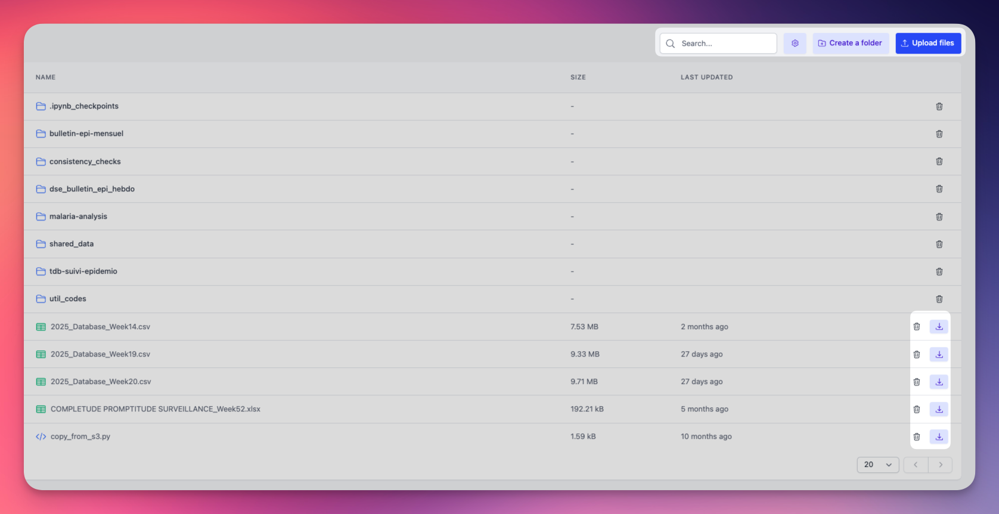

<div class="hero-section">
  <h1><i class="fas fa-hexagon" style="margin-right: 0.5rem;"></i>Fichiers</h1>
</div>
</div>
Chaque espace de travail comprend un système de fichiers partagé qui sert de fondation à l'architecture data lakehouse d'OpenHEXA. Ce système de fichiers fournit :

- Un emplacement centralisé pour stocker les fichiers de données brutes avant le traitement
- Un stockage intermédiaire pour les transformations de données et les pipelines
- Support pour les données structurées et non structurées
- Intégration avec les outils de traitement de données comme les notebooks et les pipelines



L'interface du navigateur de fichiers fournit plusieurs fonctionnalités clés :

- Rechercher des fichiers et des dossiers par nom
- Basculer la visibilité des fichiers cachés (commençant par ".")
- Créer des dossiers pour organiser votre espace de travail (Editors et Admins uniquement)
- Téléverser des fichiers ou des dossiers entiers dans votre espace de travail (Editors et Admins uniquement)

Les fichiers sont affichés dans un tableau montrant :

- Noms de fichiers/dossiers avec icônes de type
- Tailles de fichiers en format lisible
- Dates de dernière modification avec capacité de tri

Vous pouvez effectuer des opérations courantes sur les fichiers :

- Télécharger des fichiers sur votre machine locale (tous les membres de l'espace de travail)
- Supprimer des fichiers et des dossiers lorsqu'ils ne sont plus nécessaires (Editors et Admins uniquement)

!!! info "Permissions des fichiers par rôle"
    - **Viewers** : Peuvent parcourir, rechercher et télécharger des fichiers
    - **Editors et Admins** : Peuvent parcourir, rechercher, télécharger, téléverser, créer des dossiers et supprimer des fichiers

## Fichiers publics

Un espace de travail peut rendre certains de ses fichiers accessibles à tous, sans connexion. C'est utile pour alimenter une web app publique, une carte (par exemple des tuiles `.pmtiles`) ou un outil externe.

Seuls les fichiers d'un dossier nommé `public` à la racine du système de fichiers sont concernés. Chacun d'eux est accessible à une URL stable :

```
https://<votre-instance-openhexa>/files/public/<slug_du_workspace>/<chemin_dans_le_dossier_public>
```

Par exemple, `public/maps/regions.pmtiles` est servi à `/files/public/<slug_du_workspace>/maps/regions.pmtiles`.

- L'URL redirige vers un lien de téléchargement temporaire du stockage. Sur un stockage cloud (Google Cloud Storage, S3, Azure), les requêtes partielles (range) sont prises en charge. Le stockage sur système de fichiers local renvoie toujours le fichier entier.
- Les fichiers sont toujours envoyés en téléchargement : ouvrir un lien dans un onglet télécharge le fichier au lieu de l'afficher. La lecture depuis du code (`fetch()`, ``, bibliothèques cartographiques) n'est pas affectée.
- N'importe quel site web peut récupérer ces fichiers (CORS ouvert à toutes les origines). Sur Azure, l'accès depuis d'autres origines nécessite aussi de configurer CORS sur le compte de stockage, OpenHEXA ne le faisant pas.
- Le contenu des dossiers n'est jamais listé, et les fichiers en dehors du dossier `public`, ou dont le nom commence par un ".", ne sont jamais servis.
- La redirection peut être mise en cache jusqu'à 5 minutes : un fichier peut donc rester accessible quelques minutes après la désactivation du paramètre.

Les fichiers publics sont désactivés par défaut. Pour les activer :

1. L'instance doit avoir la variable d'environnement `PUBLIC_FILES_ENABLED=true`.
2. Un administrateur du workspace (ou un administrateur ou propriétaire de l'organisation) active **Fichiers publics** dans les paramètres du workspace.

Une fois activé, le dossier `public` affiche un badge **Public** et chaque fichier qu'il contient dispose d'un bouton pour copier son lien public.

!!! warning
    Toute personne disposant du lien d'un fichier public peut le télécharger. Vérifiez le contenu du dossier `public` avant d'activer le paramètre, et n'y placez jamais de données sensibles.

## Intégration avec les outils OpenHEXA

Le système de fichiers de l'espace de travail s'intègre parfaitement avec les autres composants d'OpenHEXA :

- **Notebooks** : Accédez directement aux fichiers depuis les notebooks Jupyter en utilisant le système de fichiers de l'espace de travail. Voir [Notebooks](notebooks.md).
- **Pipelines de données** : Lisez et écrivez des fichiers dans vos flux de travail de traitement de données. Voir [OpenHEXA SDK](sdk.md).
